Photos from the production of [Faculty 3](https://chicagographicdesign.shop/products/faculty-issue-3). 
Printed at [M&G Graphics](https://www.mg-graphics.com). 
On paper by [French](https://www.frenchpaper.com) and [Finch](https://www.finchpaper.com).

<figure>
  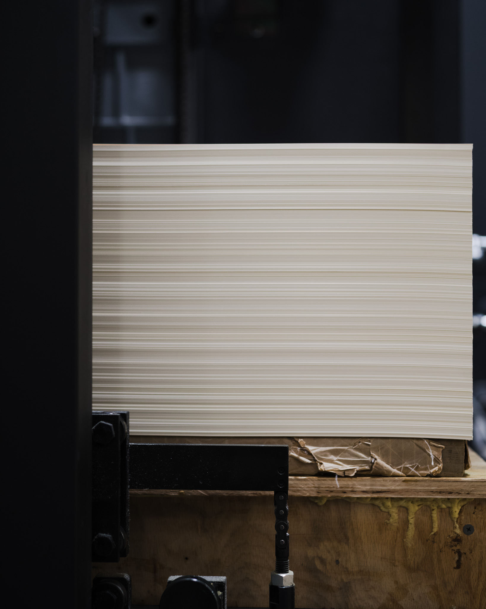
</figure>

<figure>
  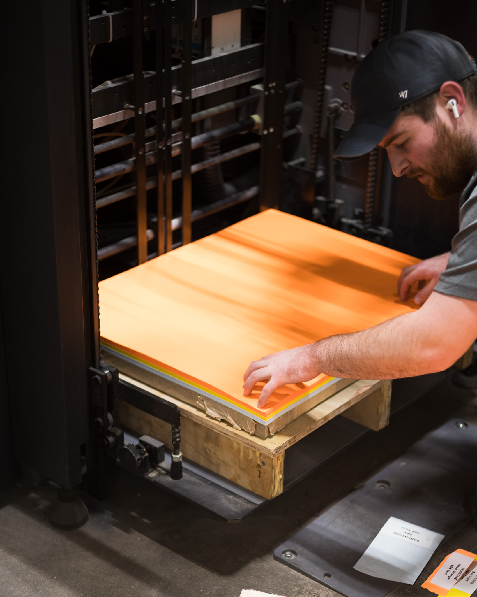
</figure>

<figure>
  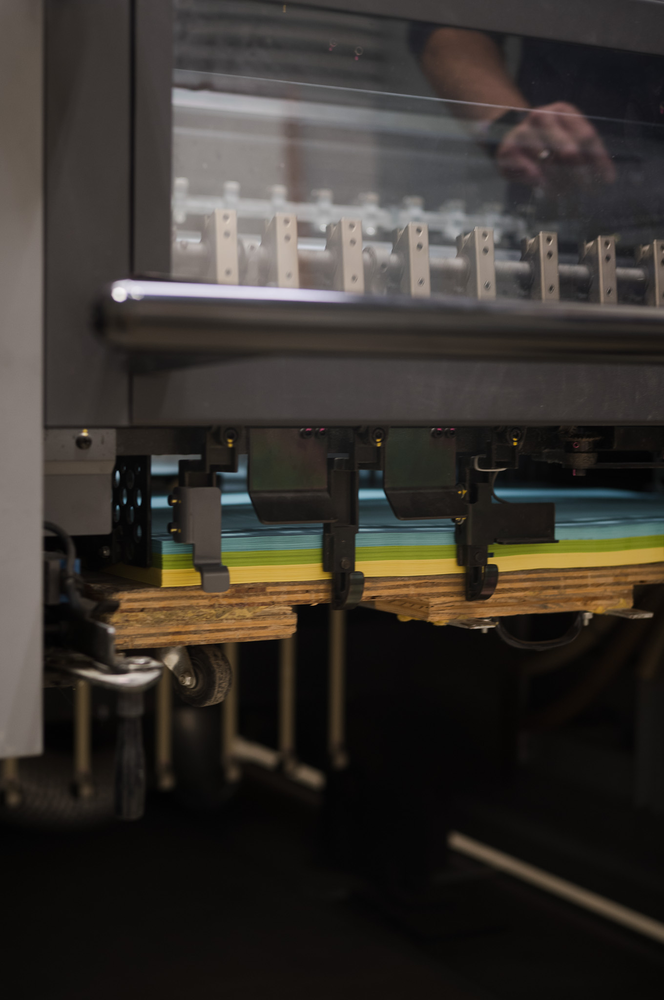
</figure>

<figure>
  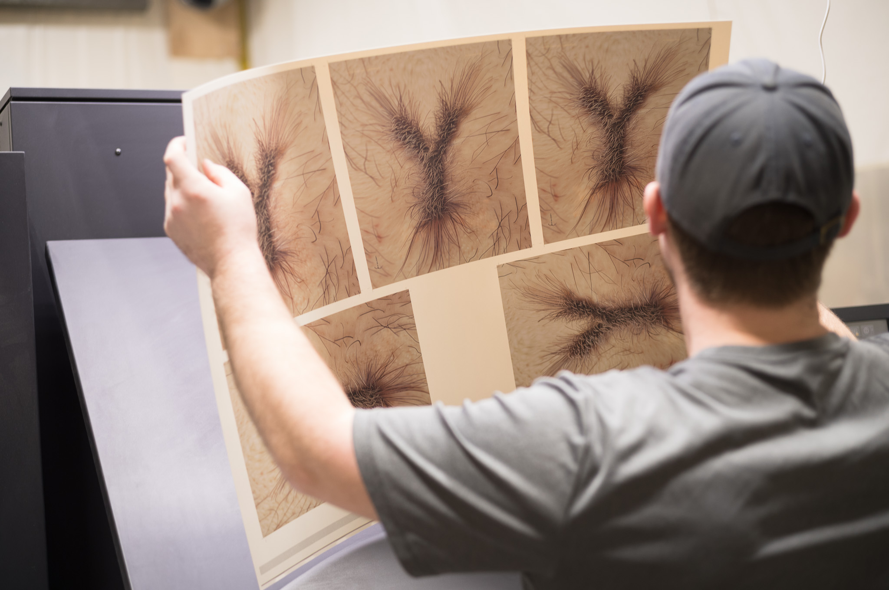
</figure>

<figure>
  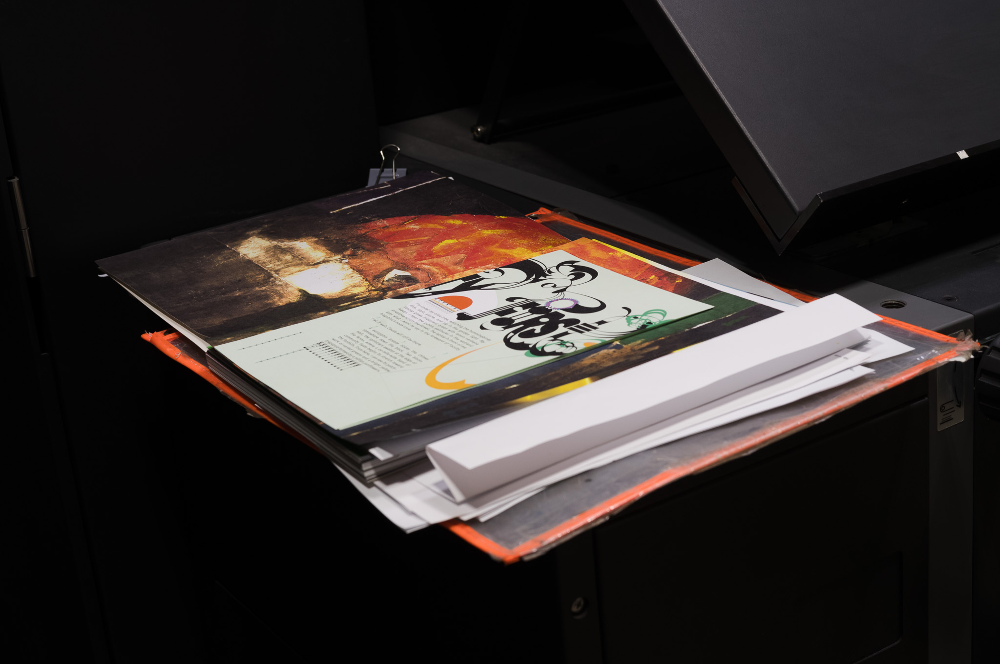
</figure>

<figure>
  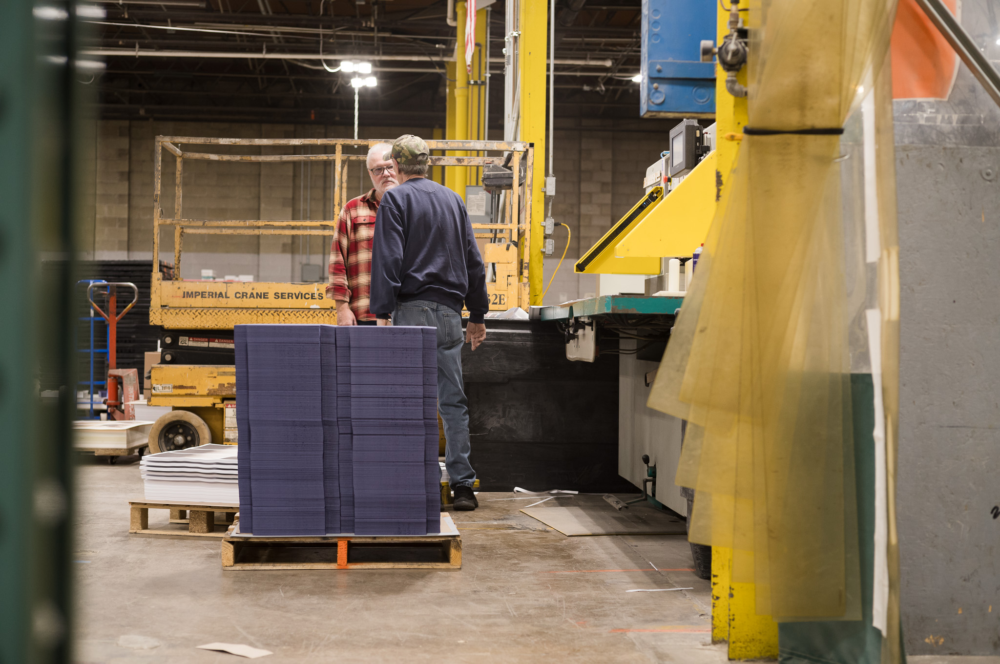
</figure>

<figure>
  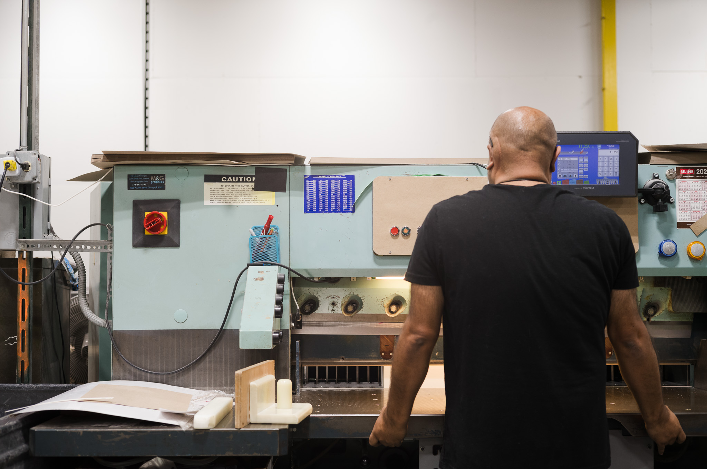
</figure>

<figure>
  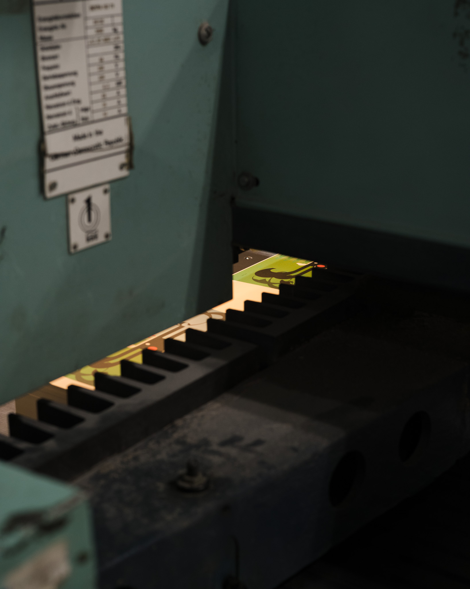
</figure>

<figure>
  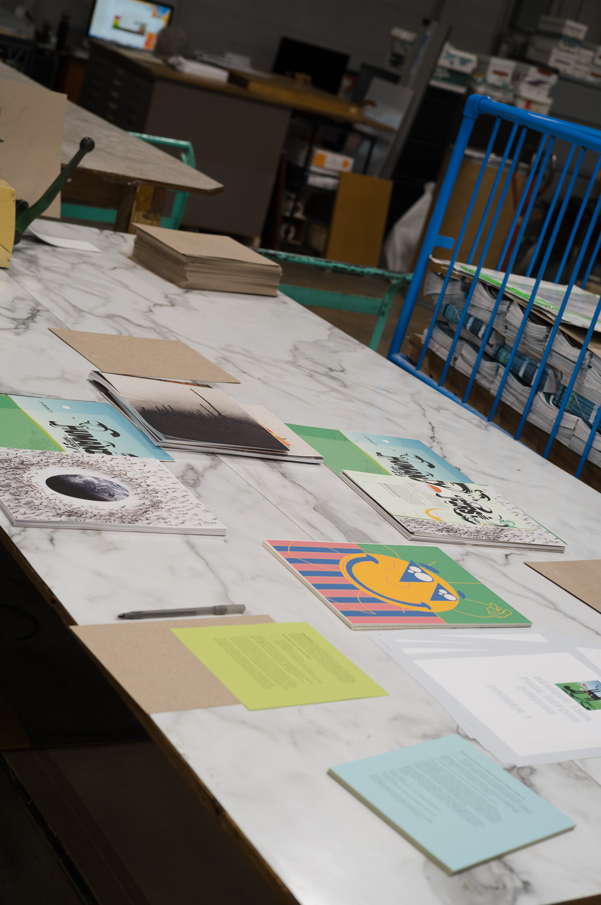
</figure>

<figure>
  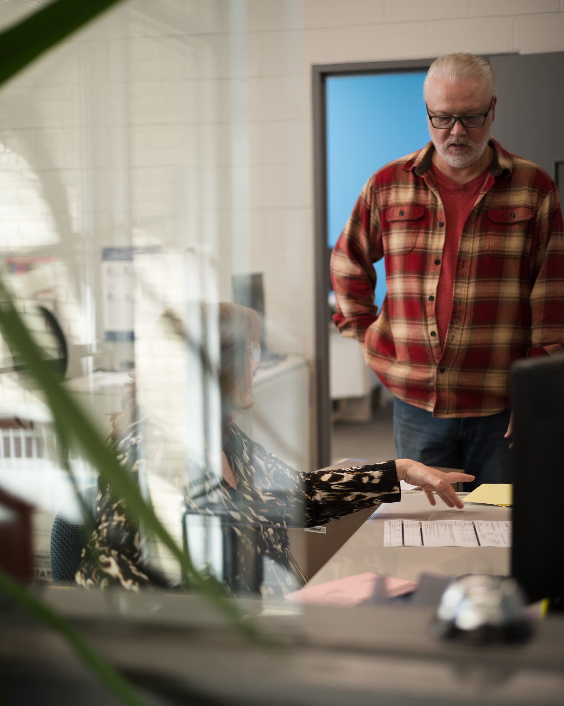
</figure>

<figure>
  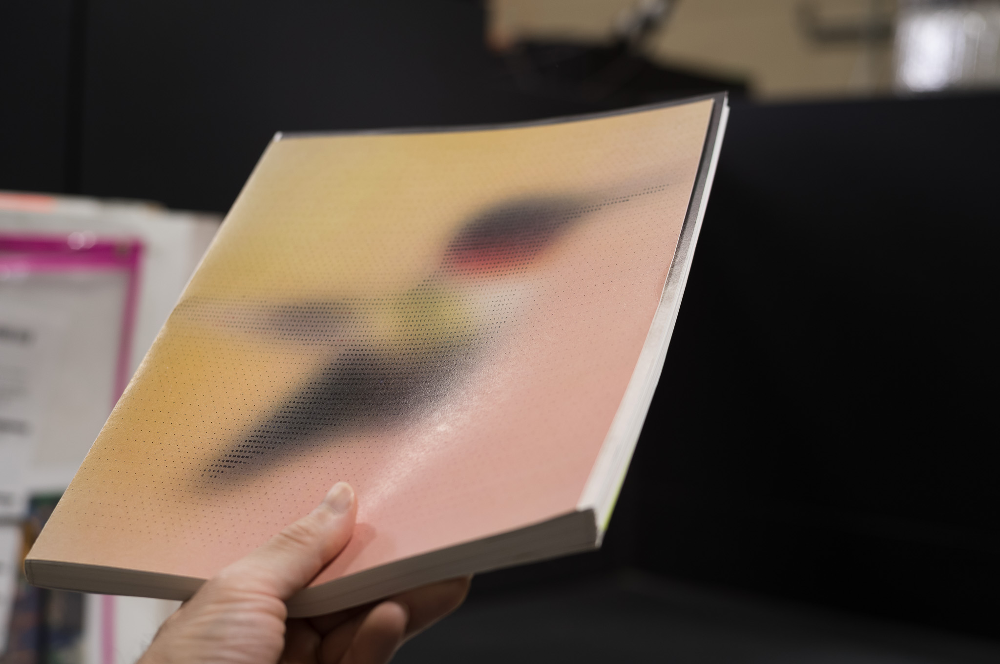
</figure>
